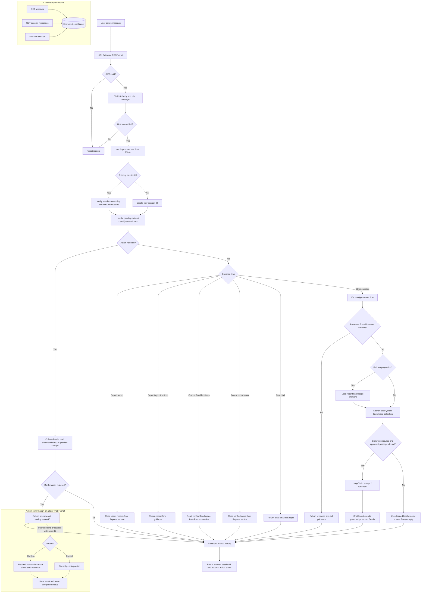

# Chatbot flow

This diagram follows the authenticated `POST /chat` request through the API gateway. Chat history endpoints are shown separately.

## Main response branches

- Actions are parsed with Gemini when configured. Changes are previewed and require explicit confirmation; reads are limited by the allowlist and actor role.
- Status, verified flood-area, and recent verified-count questions read from the Reports service.
- General questions check reviewed first-aid guidance, then search Qdrant. Gemini only receives passages from the approved chat collection; otherwise the answer uses a local excerpt or a scope fallback.
- Each successful reply is stored in the user's chat history before the API returns it. New requests create a session; follow-ups use the existing session ID.

## LangChain

LangChain (`ChatPromptTemplate`, runnables, and `ChatGoogle`) prepares grounded answer prompts and calls Gemini. Action intent extraction also uses LangChain structured output. It only classifies requests: `ChatActionService` continues to enforce the allowlist, role checks, confirmation, and operation execution.
