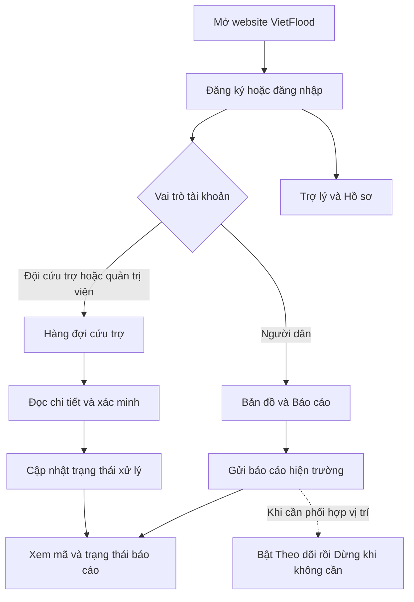
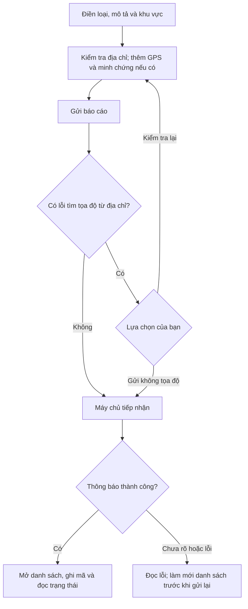
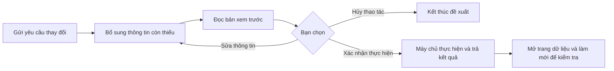

# Sổ tay hướng dẫn sử dụng website VietFlood

Tài liệu này dành cho người lần đầu sử dụng VietFlood, không yêu cầu kiến thức lập trình. Bạn sẽ biết cách tạo tài khoản, đọc bản đồ thời tiết, gửi và theo dõi báo cáo, dùng trợ lý, chia sẻ vị trí và thực hiện công việc phù hợp với vai trò của mình.

**Phạm vi:** website trên máy tính và trình duyệt điện thoại; không hướng dẫn ứng dụng di động cài riêng. Nội dung được đối chiếu với mã nguồn frontend và backend ngày **19/10/2026**, chưa kiểm thử trên website đang triển khai. Phiên bản do đơn vị vận hành cung cấp có thể khác; khi gặp khác biệt, đối chiếu tên màn hình, vai trò và thông báo đang xuất hiện.

**Cách đọc:** người dân bắt đầu từ chương 2 rồi đọc chương 3–7 và 9; đội cứu trợ và quản trị viên đọc thêm chương 8. Chương 10 có bài thực hành, lỗi thường gặp và thuật ngữ để tra cứu nhanh.

## Mục lục

1. [VietFlood là gì?](#gioi-thieu)
2. [Bắt đầu nhanh theo vai trò](#bat-dau-nhanh)
3. [Tài khoản, quyền và điều hướng](#tai-khoan)
4. [Bản đồ thời tiết](#ban-do)
5. [Tạo, xem và theo dõi báo cáo](#bao-cao)
6. [Trợ lý VietFlood và tài liệu nguồn](#tro-ly)
7. [Chia sẻ và theo dõi vị trí trực tiếp](#vi-tri)
8. [Nghiệp vụ cứu trợ và quản trị](#van-hanh)
9. [Hồ sơ và trợ giúp](#ho-so)
10. [Thực hành, xử lý sự cố và thuật ngữ](#thuc-hanh)

Các đường dẫn như `/bao-cao` là **đường dẫn trên website**, không phải địa chỉ website đầy đủ. Hãy mở địa chỉ VietFlood do đơn vị vận hành cung cấp, rồi dùng menu. Nếu cần truy cập trực tiếp, giữ nguyên tên miền và thay phần đường dẫn sau tên miền bằng đường dẫn được hướng dẫn. Không tự thêm cổng hoặc địa chỉ máy chủ.

## 1. VietFlood là gì?

VietFlood hỗ trợ xem bối cảnh thời tiết, tiếp nhận báo cáo hiện trường và phối hợp xử lý. Một **báo cáo** là bản ghi về tình trạng ngập, nhu cầu cứu hộ, hạ tầng hoặc sự cố do người dùng gửi lên hệ thống.

### 1.1. Ba nhóm người dùng

| Vai trò hiển thị | Dành cho ai? | Công việc chính |
| --- | --- | --- |
| **Người dân** | Người ghi nhận sự cố hoặc cần hỗ trợ | Xem bản đồ, gửi báo cáo, kiểm tra báo cáo của mình và chia sẻ vị trí khi cần phối hợp. |
| **Đội cứu trợ** | Nhân sự tiếp nhận và phối hợp xử lý | Rà soát báo cáo toàn hệ thống, cập nhật trạng thái, theo dõi vị trí và quản lý thông tin người dùng trong phạm vi giao diện cho phép. |
| **Quản trị viên** | Người quản lý tài khoản và vận hành | Thực hiện nghiệp vụ cứu trợ, gán vai trò và xóa tài khoản. |

Đăng ký trên website tạo tài khoản **Người dân**. Nếu bạn thuộc đội cứu trợ, hãy đăng ký rồi liên hệ quản trị viên để được gán vai trò phù hợp.

### 1.2. Phân biệt ba loại thông tin

| Thông tin | Được hình thành thế nào? | Dùng để làm gì? | Cần hiểu đúng |
| --- | --- | --- | --- |
| **Bản đồ thời tiết Windy** | Lớp dữ liệu thời tiết của dịch vụ bản đồ | Quan sát mưa, gió và bối cảnh thời tiết tại khu vực | Một vùng có mưa trên bản đồ chưa có nghĩa là đã có báo cáo ngập được xác minh. |
| **Báo cáo hiện trường** | Người dùng gửi mô tả, vị trí và minh chứng; nhân sự vận hành cập nhật trạng thái | Ghi nhận sự cố và theo dõi tiến trình xử lý | Gửi thành công mới xác nhận bản ghi được tiếp nhận; không tự xác nhận có người đến cứu trợ. |
| **Vị trí trực tiếp** | Trình duyệt gửi tọa độ khi người dùng bật chia sẻ | Hỗ trợ phối hợp theo vị trí thiết bị | Có thể chậm hoặc ngừng cập nhật khi mất mạng, mất quyền định vị hoặc rời trang. |

Báo cáo có vị trí sự cố riêng. Chia sẻ vị trí trực tiếp không tự tạo báo cáo và không tự cập nhật vị trí của báo cáo cũ.

### 1.3. Luồng sử dụng tổng quát

**Trong tình huống nguy hiểm:** ưu tiên liên hệ lực lượng hỗ trợ tại địa phương. Tin nhắn với trợ lý, trạng thái báo cáo và chỉ đường trong website không phải xác nhận điều động cứu hộ hoặc bảo đảm tuyến đường có thể đi qua.

## 2. Bắt đầu nhanh theo vai trò

### 2.1. Chuẩn bị trước khi sử dụng

Bạn cần địa chỉ website do đơn vị vận hành cung cấp, trình duyệt có kết nối mạng và tài khoản VietFlood. Khi gửi báo cáo, chuẩn bị mô tả cùng địa chỉ sự cố; ảnh minh chứng và GPS là thông tin bổ sung. Chỉ cấp quyền vị trí khi bạn cần dùng chức năng định vị.

Các ví dụ trong sổ tay dùng tên đăng nhập `hoc_vietflood_01`, email `nguoidung@example.com`, mô tả và mã báo cáo giả. Không gửi ví dụ vào hệ thống thật để thử. Khi thực hành có thay đổi dữ liệu, dùng môi trường thử nghiệm và tài khoản được đơn vị vận hành cho phép.

### 2.2. Lần đầu sử dụng với vai trò người dân

**Mục đích:** có tài khoản và gửi được báo cáo đầu tiên. **Điều kiện:** có thông tin liên hệ của chính bạn. **Điểm bắt đầu:** trang chào mừng `/`.

1. Mở **Đăng ký** hoặc vào `/dang-ky`; nhập các trường theo [mục 3.1](#dang-ky).
2. Chọn **Tạo tài khoản người dân**. Khi có thông báo **Đã tạo tài khoản**, đăng nhập bằng tên đăng nhập vừa tạo.
3. Website mở **Bản đồ**. Chọn **Hồ sơ**, kiểm tra số điện thoại, email và vai trò.
4. Chọn **Báo cáo** → **Tạo mới**; chọn loại, nhập mô tả và địa chỉ theo [mục 5.1](#tao-bao-cao).
5. Kiểm tra thông tin rồi chọn **Gửi báo cáo**.
6. Khi hiện **Đã tạo báo cáo**, tìm thẻ vừa gửi, ghi lại mã **Báo cáo #…** và chọn **Chi tiết**.
7. Khi muốn kiểm tra tiến độ, quay lại **Báo cáo**, chọn **Làm mới** và đọc trạng thái của đúng mã đó.

**Kết quả mong đợi:** báo cáo của bạn xuất hiện trong danh sách và có trạng thái hiện tại. **Nếu chưa thấy:** xóa nội dung tìm kiếm, chọn trạng thái **Tất cả** rồi **Làm mới**; kiểm tra trước khi gửi lại để tránh tạo bản trùng.

### 2.3. Lần đầu sử dụng với vai trò đội cứu trợ

**Mục đích:** tiếp nhận một báo cáo và ghi nhận tiến trình xử lý. **Điều kiện:** tài khoản đã được gán vai trò **Đội cứu trợ**. **Điểm bắt đầu:** **Cứu trợ**, `/cuu-tro`.

1. Đăng nhập; kiểm tra vai trò đang hiển thị.
2. Mở hàng đợi **Chờ xử lý**, chọn **Chi tiết** của một báo cáo.
3. Đọc mô tả, địa chỉ, minh chứng và thông tin liên hệ trước khi thực hiện công việc theo quy trình của đơn vị.
4. Khi đủ cơ sở, chọn **Đã xác minh**. Có thể dùng **Phân công** → **Nhận việc** để chuyển sang cùng trạng thái này.
5. Dùng **Theo dõi** nếu cần xem vị trí đang được chia sẻ; chỉ đường mở trong dịch vụ bản đồ bên ngoài.
6. Sau khi hoàn tất xử lý thực tế, chọn **Đã xử lý** hoặc **Hoàn tất** trong trang phân công.

**Kết quả mong đợi:** trạng thái mới được lưu và phản ánh trong danh sách. **Nếu thao tác thất bại:** đọc thông báo và **Làm mới** để kiểm tra trạng thái đã lưu trước khi thử lại. Chi tiết nghiệp vụ ở [chương 8](#van-hanh).

### 2.4. Lần đầu sử dụng với vai trò quản trị viên

**Mục đích:** kiểm tra một tài khoản và gán đúng quyền. **Điều kiện:** có vai trò **Quản trị viên**, có yêu cầu quản lý tài khoản hợp lệ. **Điểm bắt đầu:** **Người dùng**, `/nguoi-dung`.

1. Tìm người dùng bằng tên đăng nhập hoặc thông tin liên hệ.
2. Chọn đúng tài khoản; đối chiếu tên đăng nhập và mã người dùng.
3. Trong **Phân quyền**, chọn **Vai trò được gán** → vai trò phù hợp → **Gán vai trò**.
4. Chờ thông báo **Đã gán vai trò**; chọn lại tài khoản để kiểm tra.
5. Hướng dẫn người đó đăng xuất, đăng nhập lại để kiểm tra menu theo quyền mới.

**Kết quả mong đợi:** vai trò hiển thị đúng và người dùng vào được khu vực phù hợp. **Nếu không đổi được:** kiểm tra bạn có đang chọn chính tài khoản quản trị của mình hay không; giao diện không cho tự đổi vai trò tại màn hình này. Xem [mục 8.6](#gan-vai-tro).

## 3. Tài khoản, quyền và điều hướng

### 3.1. Đăng ký tài khoản người dân

**Mục đích:** tạo tài khoản để sử dụng các trang chức năng. **Vai trò và điều kiện:** người chưa có tài khoản, có email và số điện thoại liên hệ. **Đường dẫn:** `/dang-ky`; từ màn hình đăng nhập có liên kết **Tạo tài khoản**.

| Trường trên biểu mẫu | Cách điền | Yêu cầu trên giao diện |
| --- | --- | --- |
| **Tên** | Tên của bạn | Bắt buộc. |
| **Họ** | Họ của bạn | Bắt buộc. |
| **Tên đăng nhập** | Tên sẽ dùng ở màn hình đăng nhập | Bắt buộc; ghi nhớ riêng với email. |
| **Mật khẩu** | Mật khẩu bạn tự đặt | Bắt buộc; biểu mẫu yêu cầu tối thiểu 6 ký tự. |
| **Email** | Email liên hệ có dạng hợp lệ | Bắt buộc. |
| **Số điện thoại** | Số có thể liên hệ với bạn | Bắt buộc. |
| **Địa chỉ** | Số nhà, tên đường | Không bắt buộc trong biểu mẫu đăng ký. |
| **Tỉnh/Thành phố**, **Phường/Xã** | Khu vực của bạn | Không bắt buộc trong biểu mẫu đăng ký. |

1. Nhập các trường bắt buộc và thông tin địa chỉ nếu có.
2. Dùng biểu tượng con mắt **Hiện mật khẩu**/**Ẩn mật khẩu** khi cần kiểm tra ký tự.
3. Chọn **Tạo tài khoản người dân** một lần, chờ trạng thái **Đang tạo tài khoản...** kết thúc.
4. Khi thấy **Đã tạo tài khoản**, website chuyển sang trang đăng nhập.

**Kết quả mong đợi:** tài khoản người dân được tạo; bước này chưa tự đăng nhập. **Nếu thất bại:** đọc nội dung trong **Đăng ký thất bại**, sửa trường được báo lỗi; nếu máy chủ báo trùng thông tin, kiểm tra bạn đã có tài khoản hay chưa. Không có tùy chọn tự chọn vai trò cứu trợ/quản trị trên biểu mẫu công khai.

### 3.2. Đăng nhập và khôi phục phiên sử dụng

**Mục đích:** mở không gian làm việc theo vai trò. **Điều kiện:** đã có tài khoản. **Đường dẫn:** **Đăng nhập**, `/dang-nhap`.

1. Nhập **Tên đăng nhập**; không thay bằng email nếu tài khoản được cấp tên đăng nhập riêng.
2. Nhập **Mật khẩu**; dùng biểu tượng con mắt khi cần kiểm tra.
3. Chọn **Đăng nhập** và chờ xử lý.
4. Sau thông báo **Đã đăng nhập**, người dân được đưa tới `/trang-chu`; đội cứu trợ và quản trị viên tới `/cuu-tro`.

**Kết quả mong đợi:** xuất hiện điều hướng theo vai trò và tên tài khoản trên màn hình đủ rộng. **Nếu thất bại:** kiểm tra tên đăng nhập, mật khẩu và mạng. Nếu có thông báo vai trò không được hỗ trợ, liên hệ quản trị viên. Khi phiên hết hạn và website yêu cầu đăng nhập lại, lưu riêng nội dung đang soạn trước khi rời trang; không giả định biểu mẫu chưa gửi đã được lưu.

Website hiện không có luồng **Quên mật khẩu** để hướng dẫn tự đặt lại. Nếu quên mật khẩu, liên hệ đơn vị vận hành qua kênh họ đã cung cấp; không gửi mật khẩu vào trợ lý hoặc tin nhắn hỗ trợ.

### 3.3. Hiểu thanh điều hướng

- **Máy tính/màn hình rộng:** các mục chính nằm trên thanh đầu trang.
- **Điện thoại/màn hình hẹp:** các mục chuyển xuống thanh cố định cuối màn hình. Nếu không thấy khu vực trợ lý hoặc nút ở trên, cuộn trang và kiểm tra thanh dưới.
- Biểu tượng/nhãn đang được tô nổi là khu vực hiện tại.
- Biểu tượng thương hiệu **VietFlood Insight** dẫn tới trang chào mừng `/`; đây khác với trang **Bản đồ** sau đăng nhập.
- Tên tài khoản có thể bị ẩn khi màn hình hẹp; mở **Hồ sơ** để kiểm tra danh tính.

| Vai trò | Các mục chính theo thứ tự |
| --- | --- |
| Người dân | **Bản đồ → Trợ lý → Báo cáo → Theo dõi → Hồ sơ** |
| Đội cứu trợ, quản trị viên | **Cứu trợ → Trợ lý → Báo cáo → Theo dõi → Người dùng → Hồ sơ** |

Nếu chưa đăng nhập, các trang chức năng sẽ đưa bạn tới trang đăng nhập. Nếu vai trò không được phép mở một trang, website có thể chuyển bạn về trang mặc định của vai trò.

### 3.4. Danh mục trang và cách mở

| Trang | Đường dẫn trên website | Cách mở và đối tượng |
| --- | --- | --- |
| Trang chào mừng | `/` | Mở tên miền website hoặc biểu tượng thương hiệu. |
| Đăng ký | `/dang-ky` | Từ trang chào mừng hoặc liên kết **Tạo tài khoản** ở trang đăng nhập. |
| Đăng nhập | `/dang-nhap` | Nút **Đăng nhập**. |
| Bản đồ Windy | `/trang-chu` | Người dân dùng **Bản đồ**; đội cứu trợ/quản trị dùng nút **Bản đồ** trong **Cứu trợ**. |
| Trợ lý | `/chat` | Mục **Trợ lý**, cả ba vai trò. |
| Danh sách báo cáo | `/bao-cao` | Mục **Báo cáo**, cả ba vai trò với phạm vi dữ liệu khác nhau. |
| Chi tiết báo cáo | `/bao-cao/<mã báo cáo>` | Chọn **Chi tiết** từ một báo cáo có sẵn; không nhập nguyên dấu `<…>`. |
| Theo dõi | `/theo-doi` | Mục **Theo dõi**; người dân chia sẻ vị trí, nhân sự vận hành có danh sách theo dõi. |
| Cứu trợ | `/cuu-tro` | Mục **Cứu trợ**, đội cứu trợ/quản trị. |
| Phân công vận hành | `/phan-cong` | **Cứu trợ → Phân công**, đội cứu trợ/quản trị. |
| Tổng quan | `/tong-quan` | Truy cập trực tiếp khi đã đăng nhập bằng đội cứu trợ/quản trị; không có tab chính riêng. |
| Người dùng | `/nguoi-dung` | Mục **Người dùng**, đội cứu trợ/quản trị. |
| Hồ sơ | `/ho-so` | Mục **Hồ sơ**, cả ba vai trò. |
| Hướng dẫn trong website | `/huong-dan` | **Hồ sơ → Trợ giúp → Mở hướng dẫn đầy đủ**; không có tab chính riêng. |
| Tài liệu nguồn của trợ lý | `/tro-ly/nguon/<tài liệu>/<phiên bản>` | Bấm trích dẫn trong câu trả lời; không cần tự tạo đường dẫn. |

### 3.5. Bảng quyền theo giao diện

| Việc cần làm | Người dân | Đội cứu trợ | Quản trị viên |
| --- | --- | --- | --- |
| Xem bản đồ, dùng trợ lý, sửa hồ sơ cá nhân | Có | Có | Có |
| **Tạo mới** tại trang **Báo cáo** | Có | Không hiển thị nút | Không hiển thị nút |
| Xem danh sách báo cáo | Báo cáo của mình | Toàn hệ thống | Toàn hệ thống |
| **Sửa** nội dung từ danh sách báo cáo | Chính chủ, trong giới hạn ở mục 5.6 | Cùng điều kiện chính chủ | Cùng điều kiện chính chủ |
| Đổi trạng thái báo cáo | Không | Có | Có |
| Bật chia sẻ vị trí của thiết bị | Có | Có | Có |
| Xem danh sách vị trí người khác trong **Theo dõi** | Không | Có | Có |
| Cứu trợ, phân công, tổng quan | Không | Có | Có |
| Xem và sửa thông tin người dùng | Không | Có | Có |
| Gán vai trò người dùng khác | Không | Không | Có |
| Xóa tài khoản | Không | Không | Có |

Đây là bảng quyền của các màn hình thông thường. Trợ lý có danh mục thao tác riêng ở [mục 6.4](#thao-tac-tro-ly). Kết quả thay đổi dữ liệu còn phụ thuộc việc máy chủ chấp nhận yêu cầu; thấy nút hoặc bản xem trước chưa có nghĩa thao tác đã hoàn tất.

### 3.6. Đổi giao diện sáng/tối

**Mục đích:** điều chỉnh cách hiển thị cho dễ đọc. **Điều kiện:** mọi người dùng. **Điểm mở:** biểu tượng mặt trời/mặt trăng **Đổi giao diện** trên thanh đầu trang.

1. Bấm biểu tượng.
2. Chọn **Sáng**, **Tối** hoặc **Theo hệ thống**.
3. Kiểm tra màu nền và chữ; **Theo hệ thống** dùng chế độ của thiết bị.

**Kết quả mong đợi:** giao diện đổi chế độ. **Nếu một phần bản đồ vẫn có màu riêng:** nội dung bản đồ được nhúng từ dịch vụ khác và có thể không đổi giống phần còn lại của website.

### 3.7. Đăng xuất

**Mục đích:** kết thúc sử dụng tài khoản trên trình duyệt hiện tại. **Điều kiện:** đang đăng nhập. **Điểm mở:** **Đăng xuất** trên thanh đầu trang; màn hình hẹp có thể chỉ hiện biểu tượng cửa/mũi tên.

1. Lưu các thay đổi cần giữ.
2. Nếu đang chia sẻ vị trí, chọn **Dừng** trong **Theo dõi** trước khi rời đi.
3. Chọn **Đăng xuất**; chờ thông báo **Đã đăng xuất**.
4. Kiểm tra website yêu cầu đăng nhập khi mở lại một trang chức năng.

**Kết quả mong đợi:** phiên đăng nhập cục bộ được xóa. Website điều hướng qua trang bản đồ được bảo vệ và có thể tiếp tục đưa tới màn hình đăng nhập. **Nếu vẫn thấy nội dung cũ:** tải lại trang và kiểm tra trạng thái đăng nhập; không để tài khoản mở trên thiết bị dùng chung.

## 4. Bản đồ thời tiết

### 4.1. Mở bản đồ và chọn lớp dữ liệu

**Mục đích:** xem bối cảnh thời tiết của khu vực đang quan sát. **Điều kiện:** đã đăng nhập, có mạng. **Đường dẫn:** **Bản đồ**, `/trang-chu`; đội cứu trợ/quản trị vào **Cứu trợ → Bản đồ**.

1. Đợi bản đồ Windy tải xong; kéo bản đồ và dùng điều khiển thu/phóng trên bản đồ để tìm khu vực cần xem.
2. Trong nhóm công cụ bên trái phía trên bản đồ, chọn biểu tượng các lớp xếp chồng. Tên hỗ trợ là **Chọn lớp dữ liệu. Lớp hiện tại: …**.
3. Chọn lớp trong bảng dưới. Mục được tô nổi là lớp đang chọn.
4. Kiểm tra vị trí, thời điểm và chú giải màu/thang đo mà bản đồ hiển thị trước khi diễn giải dữ liệu.

| Lớp | Thông tin để quan sát |
| --- | --- |
| **Mưa** | Phân bố dữ liệu mưa theo cách hiển thị của Windy. |
| **Gió** | Hướng và tốc độ gió. |
| **Nhiệt độ** | Nhiệt độ tại khu vực. |
| **Độ ẩm** | Độ ẩm không khí. |
| **Mây** | Dữ liệu mây. |
| **Áp suất** | Dữ liệu áp suất khí quyển. |

**Kết quả mong đợi:** lớp bản đồ thay đổi tương ứng. **Nếu không tải:** kiểm tra mạng và thử tải lại; dịch vụ bản đồ có thể không truy cập được dù trang báo cáo vẫn hoạt động. Không coi bản đồ trống là bằng chứng khu vực không có sự cố.

### 4.2. Hiển thị hoặc ẩn bảng số liệu

**Mục đích:** xem thêm thông tin thời tiết hoặc mở rộng không gian bản đồ. **Điều kiện:** đang ở trang bản đồ. **Điểm mở:** nút biểu tượng ba vạch trong nhóm công cụ.

1. Bấm nút có tên **Hiển thị bảng số liệu thời tiết**.
2. Quan sát thông tin chi tiết được bật trong bản đồ.
3. Bấm lại khi tên nút là **Ẩn bảng số liệu thời tiết** để đóng.

**Kết quả mong đợi:** phần chi tiết thời tiết được bật/tắt. **Nếu dữ liệu chưa như mong muốn:** kiểm tra điểm đang chọn trong Windy và đợi bản đồ tải. Nút này không mở danh sách báo cáo ngập của VietFlood.

## 5. Tạo, xem và theo dõi báo cáo

Trang **Báo cáo** là nơi ghi nhận và kiểm tra hồ sơ sự cố. Người dân chỉ thấy báo cáo của mình; đội cứu trợ/quản trị thấy danh sách vận hành toàn hệ thống.

### 5.1. Tạo báo cáo bằng biểu mẫu

**Mục đích:** gửi thông tin sự cố hiện trường. **Vai trò và điều kiện:** người dân đã đăng nhập; có mô tả và ít nhất tỉnh/thành phố; nên cung cấp đầy đủ địa chỉ để việc xác định vị trí có ích. **Đường dẫn:** **Báo cáo → Tạo mới**, `/bao-cao`.

1. Chọn **Tạo mới** để mở biểu mẫu.
2. Trong **Loại báo cáo**, đánh dấu một hoặc nhiều loại phù hợp:

   | Loại | Cách hiểu khi chọn |
   | --- | --- |
   | **Ngập lụt** | Ghi nhận tình trạng ngập quan sát được. Đây là loại được chọn sẵn. |
   | **Cứu hộ** | Ghi nhận nhu cầu hỗ trợ/cứu hộ. |
   | **Hạ tầng** | Ghi nhận vấn đề liên quan công trình, đường hoặc hạ tầng. |
   | **Sự cố** | Ghi nhận sự cố khác cần mô tả rõ. |

3. Nhập **Mô tả**: việc gì đang xảy ra, nơi xảy ra, thời điểm quan sát và nhu cầu nếu có. Đây là trường bắt buộc. Phân biệt điều bạn trực tiếp quan sát với điều chưa biết.
4. Trong **Khu vực báo cáo**, nhập **Tỉnh/Thành phố**, rồi bấm gợi ý phù hợp để chọn. Trường này bắt buộc trên biểu mẫu.
5. Tiếp tục chọn hoặc nhập **Phường/Xã**. Nếu trường còn bị khóa, chọn tỉnh/thành phố trước. Khi đổi tỉnh, kiểm tra lại phường/xã.
6. Nhập **Địa chỉ** gồm số nhà, tên đường hoặc điểm nhận biết phù hợp. Nếu có gợi ý, chỉ chọn khi đúng nơi xảy ra sự cố. Biểu mẫu không bắt buộc phường/xã và địa chỉ bằng dấu kiểm tra nhập liệu, nhưng thiếu chúng làm vị trí khó xác định hơn.
7. Nếu đang ở đúng nơi xảy ra sự cố, có thể chọn **Dùng GPS** theo mục 5.2. Nếu đang báo hộ từ nơi khác, dùng địa chỉ sự cố; không lấy vị trí thiết bị làm vị trí sự cố.
8. Tại **Tệp minh chứng**, chọn ảnh/tệp cần gửi nếu có. Biểu mẫu hỗ trợ chọn nhiều tệp; máy chủ hiện nhận tối đa **10 tệp khi tạo**, **5 tệp khi sửa**. Không suy ra mọi định dạng đều hiển thị được như ảnh.
9. Đọc lại loại, mô tả và khu vực. Chọn **Gửi báo cáo** một lần và chờ **Đang lưu...** kết thúc.
10. Khi có thông báo **Đã tạo báo cáo**, tìm bản ghi mới và ghi lại mã.

**Kết quả mong đợi:** báo cáo xuất hiện trong danh sách. Nếu không muốn gửi, chọn **Huỷ** trước khi gửi. **Nếu thất bại:** đọc **Tạo báo cáo thất bại** và kiểm tra lỗi dữ liệu, tệp hoặc mạng. Nếu yêu cầu có thể đã được gửi nhưng màn hình chưa cập nhật, chọn **Làm mới** và tìm báo cáo trước khi gửi lại.

Ví dụ mô tả để luyện tập trên môi trường thử nghiệm:

> Ví dụ giả: Quan sát lúc 08:30, nước ngập đoạn trước số 12 Đường Minh Họa. Tôi đang báo hộ và chưa biết độ sâu. Cần kiểm tra tình trạng đi lại tại đoạn này.

Thay toàn bộ thông tin mẫu bằng dữ liệu quan sát thật khi sử dụng chính thức. Không tự thêm mức độ nghiêm trọng hoặc đánh dấu một sự việc đã được xác minh nếu bạn chưa có cơ sở.

### 5.2. Dùng GPS và kiểm tra địa chỉ

**Mục đích:** lấy vị trí thiết bị để bổ sung cho báo cáo. **Điều kiện:** trình duyệt hỗ trợ định vị; thiết bị đang ở đúng vị trí sự cố. **Điểm mở:** **Tọa độ GPS → Dùng GPS** trong biểu mẫu tạo/sửa.

1. Bấm **Dùng GPS**.
2. Khi trình duyệt hỏi quyền vị trí, chọn cho phép nếu bạn đồng ý dùng tọa độ này.
3. Đợi trạng thái **Đã ghi nhận tọa độ từ thiết bị.**; kiểm tra tỉnh/phường/địa chỉ được tự điền nếu có.
4. Sửa thông tin hành chính hoặc địa chỉ nếu chúng chưa đúng. Việc sửa địa chỉ có thể khiến website tìm lại tọa độ trước khi gửi.
5. Tiếp tục kiểm tra biểu mẫu rồi gửi.

**Kết quả mong đợi:** báo cáo có tọa độ và địa chỉ phù hợp. **Nếu hiện Vị trí bị chặn:** có thể cấp lại quyền vị trí trong cài đặt quyền của website trên trình duyệt, rồi thử **Dùng GPS**. Nếu không muốn cấp quyền, tiếp tục nhập địa chỉ. Khi hiện **Không thể tự điền địa chỉ**, tọa độ có thể đã lấy được; kiểm tra và tự hoàn thiện địa chỉ thay vì giả định GPS cũng thất bại.

### 5.3. Gửi khi không xác định được tọa độ

**Mục đích:** vẫn gửi được thông tin địa chỉ khi việc tìm tọa độ thất bại. **Điều kiện:** đã nhập thông tin biểu mẫu; xuất hiện **Không thể xác định tọa độ** và hộp hỏi **Gửi báo cáo không có tọa độ?**.

1. Đọc lại tỉnh/phường/địa chỉ.
2. Chọn **Kiểm tra lại** nếu muốn sửa địa chỉ và gửi lại.
3. Nếu địa chỉ đã đúng và chấp nhận báo cáo thiếu tọa độ, chọn **Gửi không tọa độ**.
4. Đợi thông báo tạo/cập nhật thành công; kiểm tra bản ghi trong danh sách.

**Kết quả mong đợi:** báo cáo được gửi với địa chỉ đã nhập, không có tọa độ. **Nếu vẫn thất bại:** kiểm tra các trường bắt buộc và thông báo từ máy chủ. Không phải mọi trường hợp thiếu GPS đều hiện hộp hỏi này; hộp hỏi xuất hiện khi website đã thử xác định tọa độ từ địa chỉ nhưng không thành công.

Báo cáo không có tọa độ vẫn có thể đọc mô tả và địa chỉ; các nút bản đồ/chỉ đường cần tọa độ sẽ không sử dụng được.

### 5.4. Tìm báo cáo và hiểu số liệu

**Mục đích:** tìm bản ghi đã gửi hoặc báo cáo cần xử lý. **Điều kiện:** đã đăng nhập. **Đường dẫn:** **Báo cáo**, `/bao-cao`.

1. Tại **Tìm kiếm**, nhập mã, một phần vị trí, loại báo cáo hoặc mô tả.
2. Tại **Trạng thái**, chọn **Tất cả** hoặc một trạng thái cụ thể.
3. Chọn **Làm mới** khi muốn lấy lại danh sách.
4. Đọc mã và mô tả trên thẻ để chắc chắn đã chọn đúng bản ghi; chọn **Chi tiết**.

**Kết quả mong đợi:** danh sách phù hợp đồng thời với tìm kiếm và bộ lọc. **Nếu thấy Không tìm thấy báo cáo.:** xóa tìm kiếm, chọn **Tất cả**, **Làm mới** và kiểm tra tài khoản đang dùng.

Các ô **Tổng báo cáo**, **Đang hiển thị**, **Chờ xử lý**, **Khẩn cấp** và số lượng từng trạng thái giúp đọc nhanh danh sách. **Đang hiển thị** phản ánh kết quả sau lọc; số tổng/trạng thái có thể vẫn tính trên danh sách đã tải. Dòng **Đồng bộ:** cho biết thời điểm tải dữ liệu, không bảo đảm mọi số liệu tự cập nhật liên tục.

### 5.5. Đọc chi tiết, xem minh chứng và mở bản đồ

**Mục đích:** hiểu nội dung và vị trí của một báo cáo. **Điều kiện:** có quyền xem bản ghi đó. **Đường dẫn:** thẻ báo cáo → **Chi tiết**.

1. Kiểm tra mã báo cáo, mô tả, **Loại báo cáo**, trạng thái, **Mức độ** và **Ngày tạo**.
2. Đọc **Vị trí báo cáo**: địa chỉ và tọa độ nếu có.
3. Xem **Minh chứng**; bấm ảnh để mở tệp trong tab mới. Thông báo **Báo cáo này chưa có minh chứng.** chỉ cho biết bản ghi chưa có tệp hiển thị.
4. Nếu có tọa độ, chọn **Xem bản đồ** để mở điểm trên Google Maps.
5. Đội cứu trợ/quản trị có thêm thông tin **Người báo**, liên hệ và nút **Dẫn đường**. Khi cho phép định vị, website dùng vị trí hiện tại làm điểm xuất phát; nếu không lấy được vị trí, có thể mở chỉ với điểm đến để bạn chọn điểm xuất phát trong Google Maps.
6. Chọn **Làm mới** để kiểm tra bản ghi hoặc **Danh sách** để quay lại.

**Kết quả mong đợi:** xem được thông tin đã lưu; dịch vụ bản đồ mở trong tab ngoài khi có tọa độ. **Nếu không mở được báo cáo:** kiểm tra quyền, mã bản ghi và mạng. Nếu nút bản đồ bị mờ, kiểm tra thông báo **Chưa có tọa độ**. Khi trình duyệt chặn tab mới, cho phép mở tab của website rồi thử lại.

Dấu `-` hoặc dữ liệu thiếu không có nghĩa là giá trị bằng 0. Người dân không thấy khối liên hệ người báo như nhân sự vận hành. Tuyến đường gợi ý từ dịch vụ ngoài không xác nhận khả năng đi qua vùng ngập.

### 5.6. Sửa báo cáo của mình

**Mục đích:** bổ sung hoặc sửa nội dung gửi nhầm. **Điều kiện trên giao diện:** báo cáo do chính tài khoản tạo, được tạo trong vòng **24 giờ**, chưa có trạng thái **Đã xử lý**. Quyền cứu trợ/quản trị không tự làm xuất hiện nút sửa nội dung báo cáo của người khác trong danh sách này. **Đường dẫn:** **Báo cáo** → thẻ phù hợp → **Sửa**.

1. Tìm đúng báo cáo và chọn **Sửa**.
2. Sửa mô tả, loại, khu vực hoặc thông tin cần cập nhật.
3. Nếu sửa địa chỉ, kiểm tra lại vị trí; xử lý hộp hỏi thiếu tọa độ theo mục 5.3 nếu xuất hiện.
4. Nếu thêm minh chứng mới, chọn tệp; máy chủ hiện nhận tối đa 5 tệp mới trong một lần sửa. Không có thao tác xóa minh chứng cũ trên biểu mẫu này.
5. Chọn **Lưu báo cáo**; chờ **Đã cập nhật báo cáo**, rồi mở lại **Chi tiết** để kiểm tra.

**Kết quả mong đợi:** thay đổi được lưu. Chọn **Huỷ** nếu muốn đóng phần sửa mà không gửi thay đổi. **Nếu không có nút Sửa:** kiểm tra chủ sở hữu, thời gian tạo và trạng thái. Thông báo có thể là **Bạn chỉ có thể sửa báo cáo do tài khoản của mình tạo.**, **Báo cáo chỉ được sửa trong 24 giờ sau khi tạo.** hoặc **Đã xử lý nên không thể sửa báo cáo.** Khi không sửa được, liên hệ nhân sự vận hành để xác minh thông tin cần bổ sung.

Giới hạn 24 giờ ở đây mô tả **biểu mẫu trên website**. Không suy ra mọi kênh thao tác có cùng biểu mẫu hoặc cùng cơ chế kiểm tra; trợ lý có luồng riêng ở chương 6.

### 5.7. Hiểu trạng thái báo cáo

| Trạng thái | Ý nghĩa sử dụng | Bước tiếp theo thường gặp |
| --- | --- | --- |
| **Chờ xử lý** | Bản ghi đang chờ tiếp nhận/xác minh | Người dân kiểm tra thông tin; nhân sự vận hành đọc chi tiết. |
| **Đã xác minh** | Nhân sự vận hành đã đánh dấu xác minh | Tiếp tục theo dõi hoặc thực hiện công việc theo quy trình đơn vị. |
| **Đã xử lý** | Bản ghi được đánh dấu đã xử lý | Kiểm tra kết quả nếu cần; biểu mẫu người gửi không còn cho sửa. |
| **Từ chối** | Bản ghi bị đánh dấu từ chối | Kiểm tra lại thông tin và liên hệ vận hành nếu cần làm rõ; không suy đoán lý do nếu hệ thống không nêu. |

Luồng thường dùng là **Chờ xử lý → Đã xác minh → Đã xử lý**, hoặc chuyển sang **Từ chối** khi phù hợp. Giao diện vận hành có các nút trạng thái và không bắt buộc phải đi tuần tự; đây không phải sơ đồ khóa chuyển trạng thái. Người dân không có nút tự thay trạng thái.

Trạng thái là thông tin được ghi nhận trong hệ thống, không phải thông báo tự động về giờ đến của đội cứu trợ, kết quả thẩm định độc lập hoặc bảo đảm an toàn tại hiện trường.

## 6. Trợ lý VietFlood và tài liệu nguồn

Trợ lý có hai cách hỗ trợ: trả lời kiến thức từ kho tài liệu và thực hiện một số thao tác với dữ liệu tài khoản/báo cáo khi được phép. Câu trả lời kiến thức không tự tạo hay thay đổi một báo cáo; các thao tác thay đổi dữ liệu cần bản xem trước và xác nhận.

### 6.1. Đặt câu hỏi và gửi tin nhắn

**Mục đích:** hỏi cách dùng website hoặc kiến thức có trong kho tài liệu. **Điều kiện:** cả ba vai trò đã đăng nhập, dịch vụ trợ lý hoạt động. **Đường dẫn:** **Trợ lý**, `/chat`.

1. Mở **Trợ lý**; trên màn hình rộng, **Lịch sử trò chuyện** nằm bên cạnh hội thoại.
2. Nếu muốn hỏi chủ đề mới, chọn **Cuộc trò chuyện mới**. Trên điện thoại, mở biểu tượng **Mở lịch sử hội thoại** để tìm nút này.
3. Nhập câu hỏi vào **Nhập câu hỏi của bạn...**. Nên nêu rõ bạn muốn được giải thích hay muốn thực hiện thao tác.
4. Chọn nút mũi tên **Gửi tin nhắn**. Trên bàn phím, **Enter** gửi và **Shift + Enter** xuống dòng.
5. Chờ phản hồi; tiếp tục hỏi làm rõ trong cùng hội thoại nếu cần.

**Kết quả mong đợi:** có câu trả lời hoặc thông báo giới hạn cụ thể. **Nếu không gửi được:** kiểm tra ô nhập không rỗng, mạng và phiên đăng nhập; mỗi tin nhắn giới hạn **2.000 ký tự**. Nếu quá nhiều yêu cầu, chờ sang phút tiếp theo rồi thử lại; máy chủ hiện giới hạn 20 yêu cầu chat/người dùng/phút. Khi có lỗi hiển thị, dùng **Thử lại**/**Tải lại** tương ứng với phần lỗi.

Ví dụ câu hỏi:

- “Tôi là người dân mới sử dụng. Hướng dẫn tôi gửi báo cáo không có GPS.”
- “Trạng thái Đã xác minh khác Đã xử lý như thế nào?”
- “Tôi muốn tìm hiểu cách chuẩn bị trước mùa lũ; hãy dẫn nguồn cho nội dung trả lời.”

Không coi câu trả lời là đã có nguồn nếu màn hình không hiển thị tài liệu hỗ trợ. Kho tài liệu trợ lý có thể được cập nhật riêng với sổ tay này, nên nội dung hỏi đáp về website có thể chưa phản ánh ngay mọi chi tiết mới.

### 6.2. Đọc trích dẫn và kiểm tra tài liệu nguồn

**Mục đích:** biết câu trả lời dựa trên tài liệu nào. **Điều kiện:** câu trả lời có nguồn, thường đánh số `[1]`, `[2]` và có danh sách phía dưới. **Điểm mở:** trích dẫn trong câu trả lời.

1. Đọc câu trả lời cùng các số trích dẫn.
2. Bấm một số hoặc tên tài liệu trong danh sách nguồn.
3. Tab mới mở **Tài liệu nguồn VietFlood** hoặc tên tài liệu, kèm phiên bản và nội dung bản lưu đã dùng.
4. Đọc thông báo về phiên bản. Nếu hiện bản lưu đã được thay thế hoặc nguồn đã rút khỏi kho, hiểu rằng đó là tài liệu lưu trữ của câu trả lời trước.
5. Khi có liên kết, chọn **Mở website nguồn gốc** hoặc **Mở website nguồn gốc để đối chiếu** để xem trang gốc.

**Kết quả mong đợi:** đọc được bản lưu và đối chiếu nguồn gốc khi có liên kết. **Nếu nguồn không tải:** kiểm tra đăng nhập và thử lại; không suy ra nội dung chỉ từ tiêu đề. Bản lưu trong kho có thể là bản diễn giải, và trang gốc có thể đã thay đổi sau thời điểm lưu.

Dòng **Mức bám nguồn theo kiểm tra của model: …%** biểu thị mức các khẳng định được mô hình đối chiếu với nguồn. **Đây không phải xác suất câu trả lời đúng**, mức an toàn hoặc tỷ lệ chắc chắn về tình hình tại địa phương. Không chọn một quyết định chỉ dựa vào tỷ lệ này.

### 6.3. Hiểu giới hạn của câu trả lời

| Phản hồi/tình huống | Cách hiểu và xử lý |
| --- | --- |
| Có câu trả lời kèm nguồn | Đọc nguồn và điều kiện áp dụng; kiểm tra thông tin quan trọng. |
| Chỉ trả lời được một phần | Đọc phần chưa được trả lời; hỏi riêng từng nhu cầu còn thiếu. |
| Không đủ kiến thức/nguồn phù hợp | Nêu câu hỏi cụ thể hơn; không giả định trợ lý biết nhưng đang bỏ sót dữ liệu. |
| Yêu cầu làm rõ | Bổ sung chủ đề, địa điểm hoặc thông tin mà trợ lý hỏi. |
| Dịch vụ không khả dụng | Chờ và thử lại sau; dùng các trang chức năng riêng nếu chúng còn hoạt động. |
| Hỏi mực nước, cảnh báo hoặc tình hình ngập ngay lúc này | Luồng kiến thức hiện không cung cấp số liệu thời gian thực này; kiểm tra kênh thông tin hiện hành do đơn vị có thẩm quyền cung cấp. |

Tra cứu báo cáo tài khoản là đọc dữ liệu đang lưu trong VietFlood. Nó khác với việc xác nhận một khu vực đang ngập ngay lúc này. Trợ lý hiện không có luồng tổng hợp ngập gần đây theo khu vực để hướng dẫn người dùng như một tính năng sẵn có.

### 6.4. Các thao tác dữ liệu được hỗ trợ qua trợ lý

**Mục đích:** thực hiện một yêu cầu bằng hội thoại thay vì tự điền từng trang. **Điều kiện:** đã đăng nhập đúng vai trò; dịch vụ hiểu yêu cầu và dịch vụ dữ liệu liên quan hoạt động. Các ví dụ có mã `123`/`45` là mã giả; luôn thay bằng mã đúng của bản ghi cần xử lý.

| Thao tác qua chat | Vai trò được luồng hiện tại hỗ trợ | Ví dụ yêu cầu |
| --- | --- | --- |
| Xem hồ sơ cá nhân | Cả ba | “Cho tôi xem thông tin hồ sơ của tôi.” |
| Sửa liên hệ/địa chỉ cá nhân | Cả ba | “Cập nhật địa chỉ của tôi thành …” |
| Xem báo cáo của mình | Người dân | “Liệt kê các báo cáo của tôi.” |
| Tạo báo cáo | Cả ba | “Tạo báo cáo ngập lụt với mô tả …, tại tỉnh/thành phố …, phường/xã …, địa chỉ …” |
| Sửa nội dung báo cáo | Cả ba; người dân dùng báo cáo của mình | “Sửa mô tả báo cáo 123 thành …” |
| Xóa báo cáo | Cả ba; người dân dùng báo cáo của mình | “Xóa báo cáo 123.” |
| Xem báo cáo toàn hệ thống | Đội cứu trợ/quản trị | “Liệt kê các báo cáo trong hệ thống.” |
| Đổi trạng thái báo cáo | Đội cứu trợ/quản trị | “Đổi trạng thái báo cáo 123 thành Đã xác minh.” |
| Xem danh sách/hồ sơ người dùng | Đội cứu trợ/quản trị | “Xem thông tin người dùng có mã 45.” |
| Sửa liên hệ/địa chỉ người dùng | Đội cứu trợ/quản trị | “Cập nhật địa chỉ người dùng 45 thành …” |
| Xóa tài khoản | Quản trị viên | “Xóa tài khoản có mã 45.” |

Đây là danh mục thao tác được luồng chat hỗ trợ trong mã nguồn, không phải cam kết mỗi yêu cầu diễn đạt tự do đều được nhận diện đúng. Các yêu cầu đọc danh sách hiện chỉ trình bày **tối đa 5 kết quả**; dùng trang **Báo cáo**/**Người dùng** để tìm kiếm đầy đủ.

Sửa hồ sơ qua chat hiện tập trung vào **số điện thoại, tỉnh/thành phố, phường/xã và địa chỉ**. Đổi họ tên/email dùng biểu mẫu **Hồ sơ** hoặc **Người dùng**. Gán vai trò dùng **Người dùng → Phân quyền**; không yêu cầu trợ lý đổi vai trò. Trang Báo cáo không có nút xóa báo cáo; nếu dùng khả năng xóa qua trợ lý, phải kiểm tra đúng mã và bản xem trước trước khi xác nhận.

Với sửa/xóa báo cáo, luồng chat xác định bản ghi và chủ sở hữu theo tài khoản/quyền của bạn; không hứa sẽ sửa được nếu máy chủ từ chối. Quy tắc xuất hiện nút **Sửa** trong vòng 24 giờ ở mục 5.6 thuộc biểu mẫu; không dùng lời nhắc chat như cách bảo đảm vượt qua giới hạn giao diện.

### 6.5. Xem trước, bổ sung, xác nhận hoặc hủy thao tác

**Mục đích:** thay đổi dữ liệu đúng nội dung đã xem lại. **Điều kiện:** đã gửi một yêu cầu thay đổi dữ liệu ở mục 6.4. **Điểm mở:** cùng hội thoại đang xử lý yêu cầu.

1. Gửi yêu cầu, nêu rõ mã bản ghi nếu sửa/xóa hoặc đổi trạng thái.
2. Nếu trợ lý hỏi thông tin còn thiếu, trả lời ngay trong cùng hội thoại.
3. Đọc bản xem trước: thao tác, mã, mô tả, địa chỉ và các trường dự kiến thay đổi. Một đề xuất hiện có thời hạn **15 phút**.
4. Nếu chưa đúng, gửi nội dung cần sửa và đọc lại bản xem trước mới.
5. Khi xuất hiện **Xác nhận thực hiện**, chỉ bấm nếu toàn bộ thông tin đã đúng. Nếu không muốn làm, chọn **Hủy thao tác**.
6. Chờ thông báo kết quả; mở lại trang **Báo cáo**, **Hồ sơ** hoặc **Người dùng** và làm mới để đối chiếu thay đổi.

**Kết quả mong đợi:** thao tác hoàn tất sau xác nhận, hoặc nhận thông báo đã hủy và dữ liệu chưa thay đổi. **Nếu đề xuất hết hạn:** mô tả lại yêu cầu để tạo đề xuất mới. **Nếu lỗi sau xác nhận:** kiểm tra bản ghi thực tế trước khi gửi lại, nhất là yêu cầu tạo/xóa; không dựa riêng vào tin nhắn yêu cầu của mình để kết luận thành công.

### 6.6. Tạo báo cáo qua chat, kèm GPS và ảnh tùy chọn

**Mục đích:** gửi báo cáo theo câu hỏi hướng dẫn của trợ lý. **Điều kiện:** cả ba vai trò có thể đề nghị tạo; phải cung cấp **loại, mô tả, tỉnh/thành phố, phường/xã và địa chỉ**. Đây là yêu cầu thu thập riêng của chat, khác biểu mẫu tại mục 5.1. **Đường dẫn:** **Trợ lý**.

1. Viết “Tôi muốn tạo báo cáo…” cùng thông tin đã biết.
2. Trả lời các trường còn thiếu; đọc lại bản xem trước.
3. Trong **Thông tin tùy chọn cho báo cáo**, có thể chọn **Chia sẻ GPS** nếu thiết bị đang ở đúng nơi cần báo. Cho phép trình duyệt lấy vị trí nếu đồng ý.
4. Chọn **Gỡ GPS** nếu muốn bỏ vị trí đã chọn, hoặc **Bỏ qua GPS** nếu không dùng. Việc lấy GPS trong luồng này không phải bật theo dõi liên tục.
5. Nếu có ảnh, chọn **Thêm ảnh (…/5)**. Luồng chat nhận tối đa **5 ảnh**, mỗi ảnh tối đa **5 MB**; dùng **Gỡ** bên cạnh tên ảnh nếu chọn nhầm. Ảnh chỉ hỗ trợ trong thao tác tạo báo cáo mới này.
6. Kiểm tra lại nội dung, GPS/ảnh đã chọn rồi chọn **Xác nhận thực hiện**.
7. Đợi kết quả và kiểm tra báo cáo trong trang **Báo cáo** bằng tài khoản có quyền xem phù hợp.

**Kết quả mong đợi:** báo cáo được tạo sau khi xác nhận; GPS và ảnh tùy chọn chỉ được gửi khi xác nhận tạo. **Nếu không có nút xác nhận:** hoàn thiện thông tin còn thiếu. Nếu ảnh bị từ chối, kiểm tra loại ảnh, số lượng và dung lượng. Nếu quyền GPS bị chặn, bỏ qua GPS và dùng địa chỉ chính xác.

### 6.7. Lịch sử, sao chép và xóa hội thoại

**Mục đích:** quay lại nội dung cũ hoặc quản lý hội thoại cá nhân. **Điều kiện:** đang đăng nhập đúng tài khoản đã trò chuyện. **Điểm mở:** **Lịch sử trò chuyện**; điện thoại dùng **Mở lịch sử hội thoại**.

1. Chọn tiêu đề hội thoại để mở lại; dùng **Tải hội thoại cũ hơn** khi có nút này. Trong hội thoại, dùng nút tải tin nhắn cũ nếu xuất hiện.
2. Dùng **Cuộc trò chuyện mới** để bắt đầu chủ đề khác; thao tác này không xóa hội thoại cũ.
3. Ở câu trả lời, chọn **Sao chép**; khi thành công sẽ có phản hồi đã sao chép. Nếu thất bại, có thể chọn văn bản và sao chép thủ công.
4. Nếu muốn xóa, chọn biểu tượng thùng rác của đúng hội thoại. Trên máy tính, biểu tượng có thể chỉ hiện khi đưa chuột vào hoặc dùng bàn phím chuyển tiêu điểm đến hàng đó.
5. Đọc hộp **Xóa cuộc trò chuyện?**; chọn **Hủy** để giữ hoặc **Xóa hội thoại** để xóa.

**Kết quả mong đợi:** lịch sử mở đúng nội dung, hoặc hội thoại đã xóa biến mất khỏi danh sách. **Nếu lịch sử trống/lỗi:** kiểm tra tài khoản và dùng **Tải lại**; không kết luận dữ liệu đã bị xóa chỉ vì chưa tải được. Giao diện không có thao tác hoàn tác xóa hội thoại. Xóa hội thoại không phải thao tác xóa báo cáo hoặc tài khoản đã được tạo qua chat.

## 7. Chia sẻ và theo dõi vị trí trực tiếp

Trang **Theo dõi** có phần chia sẻ vị trí của thiết bị và, với nhân sự vận hành, danh sách vị trí nhận được. Phần theo dõi hiện trình bày danh sách tọa độ với nút mở bản đồ/chỉ đường; không nên chờ một bản đồ điểm trực tiếp tích hợp xuất hiện trong trang.

### 7.1. Bắt đầu chia sẻ vị trí

**Mục đích:** gửi cập nhật vị trí thiết bị để hỗ trợ phối hợp. **Vai trò và điều kiện:** cả ba vai trò; trình duyệt hỗ trợ định vị, bạn đồng ý chia sẻ và có mạng. **Đường dẫn:** **Theo dõi**, `/theo-doi` → **Chia sẻ vị trí**.

1. Kiểm tra **Kết nối**. Khi **Mất kết nối**, việc bật chia sẻ chưa bảo đảm dữ liệu đến được bên nhận.
2. Chọn **Bắt đầu**; chấp nhận yêu cầu vị trí của trình duyệt nếu đồng ý.
3. Kiểm tra **Chia sẻ: đang bật**, **GPS gần nhất** và trạng thái kết nối.
4. Giữ trang mở khi cần tiếp tục chia sẻ. Nếu đổi thiết bị hoặc rời trang, không giả định chia sẻ vẫn hoạt động nền.
5. Thông báo với người phối hợp qua kênh liên hệ phù hợp nếu cần xác nhận họ đã nhìn thấy vị trí.

**Kết quả mong đợi:** có tọa độ gần nhất và kết nối hoạt động. **Nếu chỉ thấy đang bật nhưng GPS gần nhất là dấu `-`:** chưa đủ cơ sở kết luận đã gửi vị trí; kiểm tra quyền định vị và lỗi. Khi bị chặn, điều chỉnh quyền vị trí cho website rồi thử lại nếu muốn, hoặc tiếp tục phối hợp bằng địa chỉ.

Người dân thấy khu vực **Vị trí trực tiếp của tôi** cùng giải thích quyền. Danh sách vị trí của người khác chỉ hiển thị trong giao diện đội cứu trợ/quản trị; không coi điều này là cơ chế tự chọn danh sách người nhận cho từng lần chia sẻ.

### 7.2. Dừng chia sẻ

**Mục đích:** ngừng gửi vị trí mới. **Điều kiện:** đã bật chia sẻ. **Đường dẫn:** **Theo dõi → Chia sẻ vị trí**.

1. Chọn **Dừng**.
2. Kiểm tra **Chia sẻ: đã tắt** và nút **Bắt đầu** xuất hiện trở lại.
3. Rời trang khi không cần sử dụng; đăng xuất nếu dùng thiết bị chung.

**Kết quả mong đợi:** trình duyệt dừng theo dõi GPS và ngừng gửi cập nhật mới từ trang. **Nếu vẫn thấy GPS gần nhất hoặc người phối hợp vẫn thấy một điểm cũ:** nút **Dừng** không lập tức xóa tọa độ đã gửi, và không gửi lệnh xóa điểm đó. Bên theo dõi cần kiểm tra thời điểm cập nhật; rời trang sẽ ngắt kết nối của trang nhưng không phải cam kết xóa mọi bản sao dữ liệu ngay lập tức.

### 7.3. Xem vị trí đang được chia sẻ và mở chỉ đường

**Mục đích:** phối hợp đến một vị trí thiết bị đã chia sẻ. **Vai trò và điều kiện:** đội cứu trợ/quản trị đã đăng nhập; có dữ liệu cập nhật. **Đường dẫn:** **Theo dõi → Theo dõi trực tiếp**.

1. Đọc số lượng **đang hoạt động** và danh sách vị trí; giữ trang mở để nhận cập nhật mới.
2. Nếu cần, chọn **Làm mới**. Đọc thông báo nếu máy chủ chưa trả được danh sách hiện tại; trang có thể vẫn chờ dữ liệu trực tiếp mới.
3. Tại mỗi vị trí, kiểm tra tên hiển thị nếu có, mã kết nối, tọa độ, độ chính xác dạng `+/- …m` và thời gian cập nhật.
4. Chọn **Bản đồ** để mở điểm trên Google Maps.
5. Chọn **Dẫn đường** để mở tuyến tới điểm. Nếu không lấy được vị trí xuất phát và hiện **Chỉ dùng điểm đến**, nhập/chọn điểm xuất phát trong dịch vụ bản đồ.

**Kết quả mong đợi:** điểm hoặc chỉ đường mở ở dịch vụ ngoài. **Nếu danh sách trống:** kiểm tra kết nối, chờ người dùng bật chia sẻ và gửi vị trí mới; không suy ra không ai cần hỗ trợ. Nếu thời điểm cập nhật đã cũ, xác nhận lại qua kênh liên hệ trước khi dùng tọa độ cho công việc.

Tên có thể chỉ là **Vị trí 1**, **Vị trí 2** nếu dữ liệu không có tên tài khoản. Số đang hoạt động phản ánh dữ liệu trang nhận được, không phải tổng số người đang cần cứu trợ trên toàn khu vực. Khi thiết bị ngừng gửi nhưng kết nối còn tồn tại, điểm cũ vẫn có thể nằm trong danh sách.

## 8. Nghiệp vụ cứu trợ và quản trị

Các mục này dành cho **Đội cứu trợ** và **Quản trị viên**. Việc ghi nhận trạng thái trên website cần đi cùng quy trình xử lý thực tế của đơn vị. Thông tin liên hệ dùng để xác minh/phối hợp đúng công việc; không sao chép hoặc công khai hồ sơ người dùng ngoài nhu cầu đó.

### 8.1. Rà soát hàng đợi cứu trợ

**Mục đích:** tìm các báo cáo cần phản hồi. **Điều kiện:** tài khoản vận hành. **Đường dẫn:** **Cứu trợ**, `/cuu-tro`.

1. Xem các ô thống kê để biết khối lượng hiện tại.
2. Nhập vào **Tìm kiếm** khi cần tìm theo địa chỉ, danh mục hoặc người báo.
3. Chọn bộ lọc phù hợp trong bảng dưới.
4. Chọn **Chi tiết** trên báo cáo để đọc mô tả, địa chỉ, minh chứng và liên hệ.
5. Chọn **Làm mới** khi cần lấy lại dữ liệu; dùng **Bản đồ** để xem thời tiết hoặc **Phân công** để mở hàng đợi tiến độ.

| Bộ lọc | Ý nghĩa hiện tại |
| --- | --- |
| **Tất cả** | Mọi báo cáo trong danh sách đã tải, đồng thời áp dụng từ khóa tìm kiếm. |
| **Chờ xử lý** | Báo cáo đang chờ tiếp nhận/xác minh. |
| **Đang xử lý** | Bao gồm báo cáo đã xác minh đang được theo dõi công việc. |
| **Đã xử lý** | Báo cáo được ghi nhận đã xử lý. |
| **Sẵn tuyến đường** | Báo cáo có đủ hai tọa độ để mở công cụ bản đồ/chỉ đường; không có nghĩa tuyến đường đã được kiểm tra an toàn. |

**Kết quả mong đợi:** hàng đợi được thu hẹp theo nhu cầu. **Nếu không có kết quả:** xóa tìm kiếm, chọn **Tất cả**, **Làm mới**. Bộ lọc **Đã xử lý** không đồng nghĩa bao gồm cả **Từ chối**; dùng **Tất cả** hoặc bộ lọc trạng thái ở trang **Báo cáo** để tìm báo cáo bị từ chối.

### 8.2. Cập nhật trạng thái báo cáo

**Mục đích:** ghi nhận tình trạng xác minh/xử lý. **Điều kiện:** có quyền vận hành và đã kiểm tra đúng bản ghi. **Điểm mở:** các nút trạng thái trong **Cứu trợ**, **Báo cáo** hoặc **Chi tiết**.

1. Đối chiếu mã và nội dung để tránh chọn nhầm báo cáo.
2. Chọn **Đã xác minh**, **Đã xử lý**, **Từ chối** hoặc **Chờ xử lý** theo kết quả công việc.
3. Đợi nút **Đang lưu...** kết thúc. Nút trạng thái hiện tại bị khóa để tránh chọn lại cùng giá trị.
4. Chọn **Làm mới** hoặc mở lại chi tiết để kiểm tra trạng thái đã lưu.

**Kết quả mong đợi:** báo cáo và thống kê liên quan phản ánh trạng thái mới sau đồng bộ. **Nếu xuất hiện Cập nhật trạng thái thất bại:** đọc lỗi; giao diện có thể khôi phục trạng thái trước khi lưu. Làm mới để xác định kết quả thực tế.

Các nút trạng thái trên trang có thể gửi thay đổi ngay, không luôn có hộp xác nhận. Đọc kỹ mã trước khi bấm. Không chọn **Đã xác minh** chỉ vì một báo cáo có ảnh hoặc có tọa độ.

### 8.3. Phân công vận hành và cách hiểu tiến độ

**Mục đích:** theo dõi công việc còn mở theo trạng thái và ưu tiên của báo cáo. **Điều kiện:** tài khoản vận hành. **Đường dẫn:** **Cứu trợ → Phân công**, `/phan-cong`.

1. Đọc mã, nhãn ưu tiên, thông tin người báo, liên hệ và địa chỉ trên thẻ.
2. Chọn **Chi tiết** nếu cần xác minh trước khi thao tác.
3. Với bản ghi **Đã phân công**, chọn **Nhận việc** để chuyển báo cáo sang **Đã xác minh**.
4. Với bản ghi **Đang thực hiện**, chọn **Hoàn tất** sau khi hoàn thành công việc để chuyển báo cáo sang **Đã xử lý**.
5. Nếu cần đưa bản ghi chưa hoàn thành về chờ xử lý, chọn **Phân công lại**.
6. Chọn **Làm mới** và kiểm tra lại ở trang **Báo cáo** khi cần tìm bản ghi đã kết thúc.

**Kết quả mong đợi:** trạng thái báo cáo thay đổi tương ứng. Báo cáo **Đã xử lý** hoặc **Từ chối** được xếp vào nhóm hoàn thành và không nằm trong hàng đợi phân công còn mở. **Nếu một thẻ biến mất sau Hoàn tất:** tìm lại trong **Báo cáo**; điều này không tự có nghĩa dữ liệu đã bị xóa.

| Trạng thái của báo cáo | Nhãn suy ra trong phân công | Tiến độ hiển thị | Hành động thường có |
| --- | --- | --- | --- |
| Chờ xử lý | **Đã phân công** | 10% | **Nhận việc**, **Phân công lại**. |
| Đã xác minh | **Đang thực hiện** | 50% | **Hoàn tất**, **Phân công lại**. |
| Đã xử lý hoặc Từ chối | **Hoàn thành** | 100% | Không nằm trong hàng đợi còn mở. |

**Đã phân công** là nhãn suy ra từ trạng thái báo cáo; trang hiện không có bước chọn người nhận hoặc đội nhận. **Nhận việc** không lưu một người được giao riêng; **Phân công lại** đưa trạng thái về chờ xử lý, không mở danh sách chọn người thay thế.

Các thông tin sau cũng là giá trị suy ra để hỗ trợ sắp xếp:

| Nhãn ưu tiên | Cách suy ra trong giao diện | Hạn hiển thị tính từ ngày tạo |
| --- | --- | --- |
| **Khẩn cấp** | Báo cáo có cờ khẩn cấp | Cùng ngày. |
| **Cao** | Không có cờ khẩn cấp, mức độ từ 4 trở lên | Cộng 1 ngày. |
| **Trung bình** | Không thuộc hai nhóm trên, mức độ từ 2 trở lên | Cộng 2 ngày. |
| **Thấp** | Các trường hợp còn lại, kể cả khi không có mức độ | Cộng 3 ngày. |

Danh sách ưu tiên khẩn cấp trước, sau đó cao, trung bình và thấp. Phần trăm không đo lượng công việc thực tế; hạn không phải lịch hẹn cứu hộ hay cam kết thời gian phản hồi. Nhãn thấp khi thiếu mức độ cũng không chứng minh sự cố ít nguy hiểm; cần đọc và xác minh nội dung thực tế.

### 8.4. Xem tổng quan hệ thống

**Mục đích:** xem nhanh khối lượng công việc và các bảng tổng hợp. **Điều kiện:** đội cứu trợ/quản trị. **Đường dẫn:** truy cập trực tiếp `/tong-quan` trên cùng tên miền; trang không có mục riêng trên thanh điều hướng chính.

1. Mở đường dẫn sau khi đăng nhập.
2. Xem **Công việc đang mở** và **Cảnh báo chưa đọc**.
3. Chuyển giữa hai tab **Người dùng** và **Báo cáo** để xem bảng tổng hợp.
4. Khi cần thao tác cụ thể, mở **Người dùng**, **Báo cáo** hoặc **Cứu trợ** từ thanh điều hướng.

**Kết quả mong đợi:** có số liệu theo dữ liệu tải được. **Nếu số liệu bất thường hoặc bằng 0:** đối chiếu danh sách gốc và tải lại trang; không kết luận hệ thống không có việc chỉ từ một số tổng hợp.

Trong giao diện hiện tại, **Công việc đang mở** đếm các báo cáo chưa kết thúc; **Cảnh báo chưa đọc** được suy ra từ số báo cáo **Chờ xử lý**, không phải hộp thư thông báo có trạng thái đã đọc riêng.

### 8.5. Tìm người dùng, sửa thông tin và xem báo cáo liên quan

**Mục đích:** kiểm tra thông tin liên hệ và bối cảnh báo cáo phục vụ công việc. **Điều kiện:** đội cứu trợ/quản trị. **Đường dẫn:** **Người dùng**, `/nguoi-dung`.

1. Nhập tên, tên đăng nhập, thư điện tử hoặc số điện thoại trong ô tìm kiếm.
2. Chọn bộ lọc vai trò nếu cần; xóa tìm kiếm/chọn **Tất cả vai trò** khi muốn xem lại toàn danh sách.
3. Bấm hàng tài khoản cần xem. Khu vực **Chỉnh sửa người dùng** hiển thị tên, liên hệ và địa chỉ.
4. Nếu cần, sửa **Tên**, **Tên đệm**, **Họ**, **Địa chỉ thư điện tử**, **Số điện thoại**, **Tỉnh/Thành phố**, **Phường/Xã**, **Địa chỉ**.
5. Chọn **Lưu** để lưu thông tin hồ sơ; chờ **Đã cập nhật người dùng**.
6. Chọn lại tài khoản nếu phần chi tiết đã đóng. Đọc **Báo cáo của người dùng**, chọn **Làm mới** trong khu vực này nếu cần; chọn một báo cáo có liên kết để xem chi tiết.

**Kết quả mong đợi:** thông tin được lưu và danh sách báo cáo liên quan tải được nếu có dữ liệu. **Nếu danh sách báo cáo trống:** kiểm tra đã chọn đúng tài khoản và có lỗi tải hay không. Nếu chỉ sửa hồ sơ, nút **Lưu** không gán vai trò đang chọn trong phần phân quyền; thao tác gán vai trò có nút riêng.

Trang hiện không có biểu mẫu tạo tài khoản mới cho quản trị viên. Người mới đăng ký tài khoản người dân trước, rồi được gán vai trò theo mục tiếp theo.

### 8.6. Gán vai trò cho người dùng khác

**Mục đích:** cấp quyền phù hợp cho tài khoản đã có. **Điều kiện:** quản trị viên, đang chọn tài khoản của người khác. **Đường dẫn:** **Người dùng → chọn tài khoản → Phân quyền**.

1. Đối chiếu mã, tên đăng nhập và danh tính tài khoản cần đổi quyền.
2. Trong **Vai trò được gán**, chọn **Người dân**, **Đội cứu trợ** hoặc **Quản trị viên**.
3. Chọn **Gán vai trò**; chỉ đổi lựa chọn mà chưa bấm nút chưa lưu quyền mới.
4. Chờ **Đã gán vai trò**, rồi kiểm tra vai trò trong danh sách.
5. Yêu cầu người nhận đăng xuất và đăng nhập lại để kiểm tra menu/quyền mới; phiên đang mở có thể vẫn mang vai trò cũ.

**Kết quả mong đợi:** tài khoản có vai trò mới sau khi lưu và cập nhật phiên. **Nếu nút bị khóa:** kiểm tra bạn có đang chọn chính mình; giao diện hiện không cho tự đổi vai trò quản trị. Đội cứu trợ chỉ thấy vai trò hiện tại và thông báo chỉ quản trị viên mới có thể gán vai trò.

Thao tác này ảnh hưởng quyền truy cập dữ liệu. Gán đúng vai trò cho công việc, không dùng vai trò quản trị để thay cho việc hoàn thiện hồ sơ liên hệ.

### 8.7. Xóa tài khoản

**Mục đích:** xóa tài khoản theo yêu cầu quản lý hợp lệ. **Điều kiện:** quản trị viên; xác định chính xác đối tượng cần xóa. **Đường dẫn:** **Người dùng → chọn tài khoản → Xoá**.

1. Đọc lại mã người dùng, tên đăng nhập và thông tin liên hệ.
2. Chọn **Xoá**.
3. Đọc hộp xác nhận của trình duyệt có nội dung **Xoá [tên người dùng]?**; chọn hủy nếu chưa chắc. Nhãn nút xác nhận/hủy có thể theo ngôn ngữ trình duyệt.
4. Chỉ xác nhận khi đúng tài khoản và đúng yêu cầu.
5. Đợi **Đã xoá người dùng**; kiểm tra danh sách sau khi tải lại.

**Kết quả mong đợi:** tài khoản bị xóa khỏi danh sách theo phản hồi máy chủ. **Nếu lỗi:** đọc thông báo, làm mới và kiểm tra lại trước khi thử. Website không có nút hoàn tác xóa tài khoản; sổ tay này không cam kết việc xóa sẽ tự xóa hoặc giữ lại toàn bộ báo cáo/lịch sử liên quan. Không dùng thao tác xóa thật trong bài thực hành nhập môn.

## 9. Hồ sơ và trợ giúp

### 9.1. Kiểm tra và cập nhật hồ sơ cá nhân

**Mục đích:** giữ thông tin liên hệ và địa chỉ chính xác. **Điều kiện:** cả ba vai trò đã đăng nhập. **Đường dẫn:** **Hồ sơ**, `/ho-so`.

1. Xem **Tổng quan cá nhân**, tên đăng nhập, vai trò, thông tin liên hệ và ngày tài khoản nếu có.
2. Trong khối **Hồ sơ**, cập nhật **Tên**, **Tên đệm**, **Họ**, **Địa chỉ thư điện tử**, **Số điện thoại** và địa chỉ cần thiết.
3. Chọn/nhập **Tỉnh/Thành phố** trước **Phường/Xã**; kiểm tra lại phường/xã khi đổi tỉnh.
4. Chọn **Lưu hồ sơ**.
5. Chờ **Đã lưu hồ sơ**, kiểm tra thông tin sau khi tải lại trang.

**Kết quả mong đợi:** các trường hồ sơ được cập nhật. **Nếu Cập nhật thất bại:** kiểm tra thông báo dữ liệu và mạng; giữ bản ghi nội dung cần sửa để thử lại khi phù hợp. Không có trường tự đổi vai trò hoặc tên đăng nhập trong biểu mẫu hồ sơ này.

Chỉ số việc mở/cảnh báo trên tổng quan cá nhân được suy ra từ báo cáo theo cách giải thích ở mục 8.4; không coi số cảnh báo là số tin nhắn chưa đọc. Khối **Hành động nhanh** mở các trang phù hợp với vai trò, chẳng hạn **Mở báo cáo**, **Chia sẻ vị trí**, **Quản lý báo cáo** hoặc **Điều phối cứu trợ**.

### 9.2. Tình trạng chức năng đổi mật khẩu

**Mục đích:** biết khả năng của phần **Mật khẩu** và tránh nhầm một biểu mẫu với một chức năng đã hoạt động. **Điều kiện:** đang ở **Hồ sơ**.

**Tại thời điểm đối chiếu mã nguồn, backend chưa có chức năng đổi mật khẩu mà biểu mẫu đang gọi.** Vì vậy, chưa thể hướng dẫn đổi mật khẩu thành công như tính năng đang sẵn sàng.

1. Tìm khối **Mật khẩu**. Biểu mẫu hiển thị mật khẩu hiện tại, mật khẩu mới và xác nhận mật khẩu mới, cùng nút **Đổi mật khẩu**.
2. Nếu đơn vị vận hành thông báo đã bật chức năng trong phiên bản bạn dùng, nhập các trường theo nhãn. Giao diện kiểm tra mật khẩu mới có ít nhất 6 ký tự, khác mật khẩu hiện tại và khớp xác nhận.
3. Sau khi bấm, chỉ coi thành công nếu có phản hồi **Đã đổi mật khẩu**. Nếu thấy **Chưa đổi mật khẩu** hoặc **Chức năng đổi mật khẩu chưa khả dụng cho đến khi máy chủ bật chức năng này.**, mật khẩu chưa được xác nhận đổi.

**Kết quả ở phiên bản nguồn hiện tại:** có thể nhận thông báo chưa khả dụng. **Cách xử lý:** liên hệ đơn vị vận hành về khả năng đổi/khôi phục mật khẩu; không lặp lại cùng thao tác hoặc gửi mật khẩu cho trợ lý. Sổ tay chưa xác nhận chức năng này trên website đang triển khai.

### 9.3. Mở hướng dẫn trong website

**Mục đích:** tra cứu trợ giúp ngắn ngay trong lúc sử dụng. **Điều kiện:** cả ba vai trò. **Đường dẫn:** **Hồ sơ → Trợ giúp → Mở hướng dẫn đầy đủ**, `/huong-dan`.

1. Mở **Hồ sơ**, cuộn tới **Trợ giúp**.
2. Chọn **Mở hướng dẫn đầy đủ**.
3. Đọc phần vai trò và nhóm nội dung bạn đang cần; quay về tác vụ bằng thanh điều hướng.

**Kết quả mong đợi:** trang hướng dẫn trong website được mở. **Nếu không thấy liên kết:** truy cập trực tiếp `/huong-dan` sau khi đăng nhập. Trang trợ giúp hiện là nội dung ngắn có sẵn trong ứng dụng và có nhắc đến di động; nó chưa được thay bằng sổ tay Markdown này. Với thao tác website, ưu tiên các nhãn và phạm vi web đã giải thích trong sổ tay.

## 10. Thực hành, xử lý sự cố và thuật ngữ

### 10.1. Bài thực hành cho người dân: gửi và kiểm tra một báo cáo

**Mục tiêu:** đi từ tài khoản mới đến một báo cáo có thể tra cứu. **Điều kiện:** môi trường thử nghiệm được cho phép; tài khoản người dân. Dùng dữ liệu mẫu, không gửi sự cố giả vào hệ thống đang vận hành.

1. Đăng ký hoặc đăng nhập tài khoản thực hành.
2. Vào **Hồ sơ**, kiểm tra tên, liên hệ và vai trò **Người dân**.
3. Mở **Bản đồ**, chọn **Mưa**, rồi thử bật/tắt bảng số liệu thời tiết. Ghi nhớ đây là dữ liệu thời tiết, chưa phải báo cáo.
4. Mở **Báo cáo → Tạo mới**. Chọn **Ngập lụt**, nhập mô tả “DỮ LIỆU THỰC HÀNH: kiểm tra biểu mẫu báo cáo”, chọn khu vực theo danh sách và địa chỉ mẫu của môi trường thử nghiệm.
5. Không cấp GPS nếu tọa độ thiết bị không phù hợp; nếu xuất hiện hỏi gửi thiếu tọa độ, đọc kỹ rồi quyết định.
6. Gửi và ghi lại mã báo cáo được tạo, ví dụ giả `123`.
7. Tìm đúng mã trong **Báo cáo**, mở **Chi tiết**, đối chiếu mô tả và địa chỉ.
8. Trong 24 giờ và khi chưa **Đã xử lý**, thử **Sửa**, bổ sung mô tả rồi **Lưu báo cáo**.
9. Nếu bài thực hành có cho phép chia sẻ vị trí, mở **Theo dõi → Bắt đầu**, kiểm tra GPS rồi **Dừng**. Bỏ qua bước này nếu không có nhu cầu hoặc không được phép.
10. Đăng xuất.

**Đạt yêu cầu khi:** tìm lại được đúng bản ghi; hiểu trạng thái; phân biệt được vị trí báo cáo với chia sẻ trực tiếp và biết cách dừng. **Nếu vướng:** dùng mục tương ứng trong bảng 10.4; không tạo thêm bản trùng để thay cho việc kiểm tra kết quả gửi.

### 10.2. Bài thực hành cho đội cứu trợ: tiếp nhận và hoàn tất

**Mục tiêu:** xử lý một bản ghi thực hành từ chờ xử lý đến hoàn tất. **Điều kiện:** môi trường thử nghiệm; tài khoản đội cứu trợ; có mã báo cáo thực hành của bài trước.

1. Đăng nhập; xác nhận website mở **Cứu trợ**.
2. Tìm báo cáo thực hành bằng từ khóa/mã; mở **Chi tiết** và đối chiếu bản ghi.
3. Kiểm tra địa chỉ, minh chứng nếu có, thông tin người báo; không liên hệ thử đến số thật.
4. Vào **Cứu trợ → Phân công**, tìm đúng mã, chọn **Nhận việc**.
5. Mở **Báo cáo** và kiểm tra trạng thái **Đã xác minh**; hiểu rằng **Nhận việc** không chọn một người nhận riêng.
6. Nếu có tọa độ mẫu, thử **Xem bản đồ**/**Dẫn đường**; không dùng chỉ đường để suy ra an toàn tuyến.
7. Trong môi trường thử nghiệm, chọn **Hoàn tất** hoặc **Đã xử lý** theo bài tập.
8. Xác nhận thẻ không còn trong hàng đợi phân công mở; tìm lại ở **Báo cáo** với **Trạng thái → Đã xử lý**.

**Đạt yêu cầu khi:** đúng bản ghi chuyển trạng thái, vẫn tra cứu được sau khi kết thúc; không nhầm thẻ rời hàng đợi với bị xóa. **Nếu lỗi lưu:** làm mới và kiểm tra trạng thái thực tế trước khi thao tác lại.

### 10.3. Bài thực hành cho quản trị viên: gán quyền và kiểm tra menu

**Mục tiêu:** cấp vai trò đội cứu trợ cho một tài khoản thử nghiệm. **Điều kiện:** môi trường thử nghiệm; một tài khoản quản trị và một tài khoản người dân khác.

1. Mở **Người dùng**, tìm chính xác tài khoản thực hành bằng tên đăng nhập.
2. Chọn tài khoản, đọc mã và liên hệ để tránh nhầm người.
3. Trong **Phân quyền**, chọn **Đội cứu trợ**, bấm **Gán vai trò** và chờ thông báo.
4. Đăng xuất tài khoản thực hành ở trình duyệt của nó rồi đăng nhập lại.
5. Xác nhận tài khoản đó vào **Cứu trợ**, có mục **Người dùng**, nhưng không có quyền gán vai trò/xóa tài khoản như quản trị viên.
6. Nếu bài tập yêu cầu trả trạng thái ban đầu, dùng tài khoản quản trị gán lại **Người dân** cho tài khoản thử nghiệm và kiểm tra sau đăng nhập lại.
7. Không dùng xóa tài khoản như một bước kiểm thử nhập môn.

**Đạt yêu cầu khi:** vai trò đã lưu và menu thay đổi sau khi cập nhật phiên; hiểu rằng **Lưu** hồ sơ và **Gán vai trò** là hai thao tác khác nhau. **Nếu chưa đổi menu:** kiểm tra vai trò trên danh sách quản trị và tài khoản đang đăng nhập trước khi gán lại.

### 10.4. Bảng xử lý sự cố thường gặp

| Triệu chứng/thông báo | Điều cần kiểm tra | Bước tiếp theo |
| --- | --- | --- |
| **Thiếu thông tin** khi đăng nhập | Có bỏ trống tên đăng nhập hoặc mật khẩu? | Nhập cả hai trường, chọn **Đăng nhập**. |
| **Đăng nhập thất bại** | Đúng tên đăng nhập, mật khẩu, mạng và vai trò được hỗ trợ? | Đọc lỗi; liên hệ vận hành khi tài khoản/quyền không đúng. Không chia sẻ mật khẩu. |
| Không có mục **Cứu trợ**/**Người dùng** | Vai trò hiện tại có phải người dân? | Nhờ quản trị kiểm tra quyền; đăng nhập lại sau khi được gán đúng vai trò. |
| Mở trang rồi bị đưa về trang khác | Chưa đăng nhập hoặc vai trò không được vào? | Đăng nhập đúng tài khoản, dùng trang được phép. |
| **Đang kiểm tra quyền truy cập...** kéo dài | Phiên đăng nhập, mạng hoặc tải hồ sơ bị lỗi? | Tải lại; đăng nhập lại nếu cần. Giữ riêng nội dung chưa gửi trước khi rời trang. |
| Không thấy tab trên điện thoại | Đang dùng bố cục màn hình hẹp? | Kiểm tra thanh cuối màn hình; trợ lý có nút mở lịch sử riêng. |
| Windy không tải | Mạng hoặc dịch vụ bản đồ ngoài có bị gián đoạn? | Tải lại; dùng trang báo cáo độc lập nếu vẫn hoạt động. |
| Không có **Tạo mới** trong Báo cáo | Đang dùng đội cứu trợ/quản trị? | Đây là cách hiển thị hiện tại; người dân tạo bằng biểu mẫu, trợ lý có luồng tạo riêng. |
| **Vị trí bị chặn** | Quyền vị trí cho website/thiết bị đã được cấp? | Cấp quyền nếu đồng ý rồi thử lại; báo cáo có thể dùng địa chỉ thay GPS. |
| **Không thể tự điền địa chỉ** | Tọa độ đã được lấy nhưng địa chỉ chưa có? | Kiểm tra tọa độ và nhập địa chỉ thủ công. |
| **Không thể xác định tọa độ** | Địa chỉ có đủ và chính xác? | **Kiểm tra lại**, hoặc xác nhận **Gửi không tọa độ** nếu chấp nhận. |
| **Không tìm thấy báo cáo.** | Tìm kiếm/bộ lọc, đúng tài khoản, đúng phạm vi vai trò? | Xóa tìm kiếm → **Tất cả** → **Làm mới**. |
| Không có **Sửa** | Chính chủ, chưa quá 24 giờ và chưa xử lý? | Kiểm tra ba điều kiện; liên hệ vận hành nếu cần bổ sung ngoài khả năng biểu mẫu. |
| Không có tọa độ/nút bản đồ bị khóa | Báo cáo được gửi thiếu tọa độ? | Dùng địa chỉ để xác minh; không tự coi địa chỉ là tọa độ đã được kiểm chứng. |
| Tab Google Maps/ảnh không mở | Trình duyệt có chặn tab mới? | Kiểm tra quyền mở tab và mạng; thử lại. |
| Trợ lý không trả lời điều kiện ngập hiện tại | Câu hỏi yêu cầu dữ liệu thời gian thực? | Hiểu giới hạn; không coi việc không có câu trả lời là không có ngập. |
| **Không tải được nguồn. Hãy kiểm tra đăng nhập và thử lại.** | Phiên đăng nhập, mạng hoặc nguồn có sẵn? | Đăng nhập lại/thử lại; không diễn giải nội dung chưa tải được. |
| Trợ lý yêu cầu thêm thông tin | Thiếu mã hoặc trường bắt buộc? | Bổ sung trong cùng hội thoại, kiểm tra bản xem trước mới. |
| Đề xuất chat không còn xác nhận được | Quá 15 phút, vai trò/phiên đổi hoặc đã xử lý? | Kiểm tra dữ liệu thực tế, tạo lại yêu cầu nếu còn cần. |
| Ảnh trong chat bị từ chối | Đúng ảnh, tối đa 5 ảnh, mỗi ảnh không quá 5 MB? | Gỡ ảnh không phù hợp, chọn lại. |
| Chat yêu cầu chờ vì gửi quá nhiều | Đã gửi nhiều yêu cầu trong một phút? | Chờ sang phút tiếp theo; tránh nhấn gửi/xác nhận liên tục. |
| **Mất kết nối** trong Theo dõi | Mạng hoặc dịch vụ trực tiếp lỗi? | Khôi phục mạng; kiểm tra lại kết nối và GPS mới nhất. |
| **Chia sẻ: đang bật** nhưng chưa có GPS | Quyền vị trí và việc lấy tọa độ đã thành công? | Kiểm tra lỗi/quyền, không coi chữ đang bật là xác nhận bên kia nhận được tọa độ. |
| Đã **Dừng** nhưng vẫn thấy vị trí cũ | Đang xem tọa độ cuối cùng đã gửi? | Kiểm tra thời gian cập nhật; Dừng ngừng gửi mới, không lập tức xóa điểm cũ. |
| Hàng đợi phân công thiếu báo cáo vừa hoàn tất | Báo cáo đã **Đã xử lý** hoặc **Từ chối**? | Tìm tại **Báo cáo**, vì phân công chỉ hiển thị việc chưa kết thúc. |
| Sửa hồ sơ người dùng nhưng vai trò chưa đổi | Chỉ chọn **Lưu**? | Quản trị viên phải dùng **Gán vai trò** riêng. |
| Không tự đổi vai trò quản trị được | Đang chọn chính tài khoản hiện tại? | Giao diện không hỗ trợ tự đổi vai trò ở đây; phối hợp với quản trị viên phù hợp. |
| **Chưa đổi mật khẩu**/**chưa khả dụng** | Máy chủ đã hỗ trợ chức năng chưa? | Liên hệ vận hành; không khẳng định mật khẩu đã đổi và không lặp lại vô ích. |

Khi cần báo lỗi cho người hỗ trợ, chuẩn bị: vai trò, tên trang/đường dẫn, thao tác vừa làm, thông báo nguyên văn, mã báo cáo/người dùng liên quan và thời điểm xảy ra. Không gửi mật khẩu hoặc thông tin nhạy cảm không cần thiết. Sổ tay không tự đặt ra địa chỉ hỗ trợ hoặc số điện thoại; dùng kênh do đơn vị vận hành cung cấp.

### 10.5. Câu hỏi thường gặp

**Tôi đã đăng ký, vì sao vẫn phải đăng nhập?** Đăng ký chỉ tạo tài khoản. Sau thông báo thành công, dùng tên đăng nhập và mật khẩu ở màn hình đăng nhập.

**Tôi chọn Cứu hộ, có nghĩa đã gọi được đội cứu trợ chưa?** Chưa. Đó là loại báo cáo. Kiểm tra mã/trạng thái và phối hợp qua kênh phù hợp; website không xác nhận điều động chỉ bằng loại báo cáo.

**Tôi gửi hộ người khác, nên lấy GPS nào?** Vị trí báo cáo phải là nơi xảy ra sự cố. Nếu thiết bị ở nơi khác, nhập địa chỉ sự cố và không dùng GPS thiết bị như tọa độ sự cố.

**Tôi có thể gửi báo cáo không có ảnh hoặc GPS không?** Có, ảnh và GPS là thông tin tùy chọn. Vẫn phải nhập thông tin bắt buộc của luồng đang dùng; chat yêu cầu cả phường/xã và địa chỉ. Xác nhận gửi thiếu tọa độ nếu website hỏi.

**Tôi đã gửi qua trợ lý, có cần gửi thêm bằng biểu mẫu không?** Nếu trợ lý xác nhận tạo thành công, kiểm tra bản ghi trước. Không gửi lần nữa chỉ để báo cáo xuất hiện ở một kênh khác.

**Tại sao tôi chỉ thấy vài báo cáo trong chat?** Câu trả lời danh sách hiện giới hạn tối đa 5 kết quả. Dùng trang Báo cáo để tìm kiếm và lọc theo phạm vi tài khoản.

**Đã phân công có nghĩa ai đó cụ thể được giao việc?** Chưa. Trang hiện suy ra nhãn này từ trạng thái Chờ xử lý và không có bước chọn người nhận. Việc phân người thực tế cần theo quy trình đơn vị.

**Từ chối có phải đã giải quyết được sự cố?** Không. Giao diện phân công nhóm bản ghi từ chối vào hoàn thành để loại khỏi hàng đợi mở; trạng thái gốc vẫn là Từ chối. Kiểm tra đúng trạng thái ở chi tiết.

**Đổi hồ sơ có làm đổi địa chỉ trên báo cáo cũ không?** Không có thao tác được mô tả ở đây tự sửa toàn bộ báo cáo cũ. Kiểm tra từng báo cáo và sửa qua luồng phù hợp nếu cần.

**Tôi đóng cuộc trò chuyện hoặc đăng xuất thì báo cáo có bị xóa không?** Các thao tác này không phải lệnh xóa báo cáo. Xóa báo cáo là một yêu cầu riêng; không nhầm nó với xóa hội thoại.

**Điện thoại khóa màn hình, vị trí có tiếp tục cập nhật không?** Không có bảo đảm theo dõi nền từ luồng trình duyệt này. Giữ trang hoạt động khi cần phối hợp và kiểm tra tọa độ/thời điểm cập nhật thay vì giả định vẫn đang gửi.

**Tỷ lệ bám nguồn cao có bảo đảm câu trả lời đúng không?** Không. Đó là đánh giá đối chiếu nguồn của mô hình, không phải xác suất đúng hoặc chứng nhận của chuyên gia.

### 10.6. Thuật ngữ dùng trong website

| Thuật ngữ | Nghĩa trong tài liệu |
| --- | --- |
| **Tài khoản** | Danh tính dùng để đăng nhập VietFlood. |
| **Vai trò** | Nhóm quyền: người dân, đội cứu trợ hoặc quản trị viên. |
| **Phiên đăng nhập** | Trạng thái trình duyệt đang sử dụng một tài khoản; có thể hết hạn. |
| **Báo cáo / Mã báo cáo** | Bản ghi sự cố/nhu cầu và mã để tìm lại bản ghi đó. |
| **Trạng thái** | Tình trạng tiếp nhận/xử lý đang được ghi trong hệ thống. |
| **Xác minh** | Nhân sự vận hành đã đánh dấu kiểm tra; cần hiểu theo quy trình đơn vị. |
| **Minh chứng** | Ảnh/tệp bổ sung cho nội dung báo cáo. |
| **GPS / Tọa độ** | Vị trí thiết bị hoặc điểm trên bản đồ, thường gồm vĩ độ và kinh độ. |
| **Định vị địa chỉ** | Website tìm tọa độ từ địa chỉ bạn nhập; giao diện có thể gọi là geocode. |
| **Theo dõi trực tiếp** | Nhận cập nhật tọa độ từ thiết bị đang chia sẻ và còn kết nối. |
| **Độ chính xác** | Ước lượng sai số vị trí hiển thị khi có dữ liệu, chẳng hạn `+/- 20m`. |
| **Phân công** | Trang theo dõi công việc suy ra từ báo cáo; hiện chưa chọn người nhận riêng. |
| **Ưu tiên / Khẩn cấp** | Nhãn dựa trên thông tin báo cáo để hỗ trợ rà soát. |
| **Đồng bộ / Làm mới** | Tải lại dữ liệu; nội dung trước khi làm mới có thể đã cũ. |
| **Trích dẫn / Nguồn** | Tài liệu được trợ lý dùng để hỗ trợ một câu trả lời. |
| **Bản lưu nguồn / Phiên bản** | Nội dung nguồn được lưu cho lần trả lời, có thể khác website gốc hiện tại. |
| **Mức bám nguồn** | Đánh giá của mô hình về đối chiếu khẳng định với nguồn; không phải xác suất đúng. |
| **Bản xem trước / Đề xuất** | Nội dung thao tác trợ lý trình bày trước khi bạn xác nhận thay đổi dữ liệu. |

### 10.7. Phạm vi kiểm chứng và cập nhật sổ tay

Tài liệu mô tả hành vi được đối chiếu từ mã nguồn website và dịch vụ xác thực, báo cáo, theo dõi và trợ lý ngày 19/10/2026. Chưa dùng tài khoản thật để thực hiện toàn bộ hành trình trên website đang triển khai; chưa xác nhận tình trạng dữ liệu, mạng, dịch vụ bản đồ ngoài hoặc dịch vụ trợ lý của một bản triển khai cụ thể.

Khi giao diện hoặc nghiệp vụ thay đổi, người duy trì cần rà lại: menu theo vai trò, quyền hiển thị, trường bắt buộc, thông báo/nút thao tác, luồng xác nhận, giới hạn tệp, trạng thái báo cáo và chức năng chưa khả dụng. Chỉ cập nhật ngày kiểm chứng và mức kiểm chứng theo việc thực sự đã làm. Bản sổ tay này không tự thay đổi nội dung hướng dẫn trong website hoặc kho tài liệu mà trợ lý đang tra cứu.

[Quay lại mục lục](#muc-luc)
